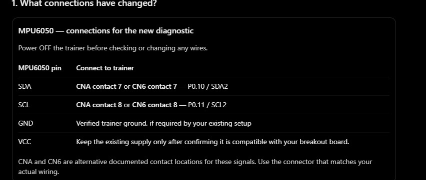
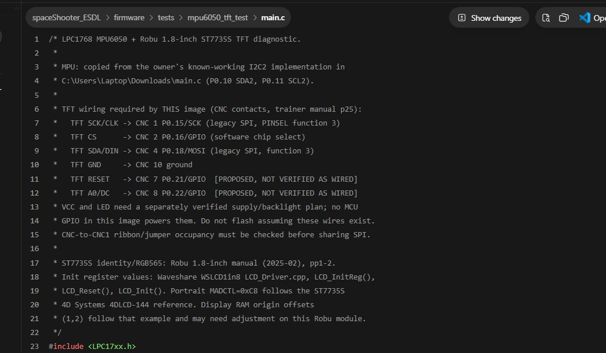

# Working MPU6050 + TFT hardware connection record

**Combined-test record dated 27 October 2026.** The owner reports that the MPU6050 and 1.8-inch TFT operated together on the physical LPC1768 trainer. This is a **user-reported physical pass**; this document does not claim an independent inspection, continuity measurement, voltage measurement, or witnessed Flash Magic log. The exact HEX programmed and several wire endpoints have not yet been recorded. The current M5 map below is a later documentation update, not a new combined-test observation.

This record preserves the working behavior while separating it from what source code and manuals establish. The older [hardware-readiness audit](hardware-readiness.md), [assumption register](../firmware/HARDWARE_ASSUMPTIONS.md), and [interactive manual](index.html) predate the new user report; their “no physical pass” statements describe their earlier evidence state and were not silently edited here.

**M7 status update, 29 October 2026:** The [isolated M7 source](../firmware/tests/decision_tree_m7/main.c) retains the same I²C2, TFT and SW2 interfaces as M5 and changes only the steering classification decision. The owner reports flashing M7 and seeing gameplay that appears the same as M5. This adds a qualitative board observation, **not** a new wire-by-wire inspection, voltage measurement or confirmed module rating. The M5 signal map below remains the applicable documented route for M7; exact fitted contacts and electrical levels are still unverified.

## Current M5 signal map for the IEEE report

This is the **source- and trainer-manual-supported signal plan** for the [M5 game source](../firmware/tests/restart_highscore_m5/main.c), with the owner's reported SW2 ribbon and working game noted separately. The 27 October combined-test evidence below remains historical. A functioning game does not establish each installed contact, jumper, supply voltage, or signal level. The [current-state index](../docs/CURRENT_STATE_AND_EVIDENCE_2026-10-29.md) and [M5 physical record](../firmware/tests/restart_highscore_m5/PHYSICAL_VERIFICATION.md) define the physical evidence boundary.

| Module signal | LPC1768 interface and pin | Documented trainer route / requirement | Evidence boundary |
| --- | --- | --- | --- |
| MPU6050 SDA | I²C2, P0.10/SDA2 | **Either** CNA contact 7 **or** CN6 contact 7 | Both locations expose the same MCU signal; actual selected contact and wire continuity are not recorded. |
| MPU6050 SCL | I²C2, P0.11/SCL2 | **Either** CNA contact 8 **or** CN6 contact 8 | Both locations expose the same MCU signal; actual selected contact and wire continuity are not recorded. |
| MPU6050 GND | Common ground | Connect to a verified trainer ground | Required return path; exact fitted ground contact and continuity are not recorded. |
| MPU6050 VCC | Module supply | Use a supply compatible with the **actual breakout board** | Owner reported a 5 V connection; the breakout's 5 V input and I/O-level compatibility are not established. |
| TFT SCK/CLK | Legacy SPI0, P0.15/SCK0 | CNC contact 1 | Source and manual support this signal; installed wire not individually verified. |
| TFT SDA/DIN | Legacy SPI0, P0.18/MOSI0 | CNC contact 4; this `SDA` is **SPI data**, not I²C | Source and manual support this signal; installed wire not individually verified. |
| TFT CS | GPIO output, P0.16 | CNC contact 2; active-low **software** chip select, not the SSEL0 peripheral function | Source and manual support this signal; installed wire not individually verified. |
| TFT GND | Common ground | CNC contact 10 | Documented contact in the source plan; installed return path and continuity not recorded. |
| TFT RESET | GPIO output, P0.21 | CNC contact 7 | Source-required GPIO and proposed connector route; installed wire not verified. |
| TFT A0/DC | GPIO output, P0.22 | CNC contact 8 | Source-required GPIO and proposed connector route; installed wire not verified. |
| TFT VCC / LED | Module supply / backlight | Compatible supply and reviewed backlight current path | Owner reported a 5 V connection; exact module input rating, MCU-facing I/O levels, and supply/backlight route are not established. |
| SW2 | GPIO input, P2.12; reported active low, firmware pull-up | **CNB-to-CNB1 FRC ribbon** to the trainer SW2 circuit | Owner reports the ribbon and working restart. The CNB1 contact number is disputed by manuals; contact continuity and released/pressed voltages were not measured. |

CNA and CN6 are **alternative contact locations**, not two simultaneous MPU6050 connections. The old CNC 5/P0.19/SDA1 and CNC 6/P0.20/SCL1 entries in the [pre-integration assumption register](../firmware/HARDWARE_ASSUMPTIONS.md) describe an **earlier I²C1 diagnostic proposal**, not the M3–M5 game wiring. Do not substitute them for I²C2. M5 uses the LPC1768 **legacy SPI peripheral** for TFT clock/data and GPIO for CS, RESET, and A0/DC; `SSEL0` on the trainer's CNC 2 label is a pin capability, not the configured chip-select function.

Before reproducing this map on another assembly, record the selected CNA **or** CN6 path, connector pin-1 orientation, actual MPU/TFT ground and supply contacts, module revisions and voltage ratings, I²C pull-up rail, and continuity to each module pin. Check any CNA-to-CNA1, CNC-to-CNC1, and CNB-to-CNB1 ribbons and current jumper positions for shared contacts. In particular, CNC-to-CNC1 can expose the SPI lines to onboard U5/U6 paths selected by JP12/JP13; confirm occupancy before sharing them. SW2's reported active-low behavior does not replace a safe released/pressed voltage check at P2.12.

## Evidence and status terms

- **User-confirmed working:** the owner's report of live MPU6050 readings on the TFT during the combined physical test. It establishes that the assembled system functioned, but does not identify every contact, voltage, jumper, or programmed file.
- **Source-supported:** a pin function or setting configured by the identified repository source. It is the wiring *required by that source*, not proof that the actual wire follows it.
- **Manual-supported:** a connector contact or module label documented by a cited manual or photograph. It does not prove a cable was installed there.
- **Unverified route:** the exact physical endpoint, cable, supply, or electrical characteristic has not been supplied.

Sources inspected: [`firmware/tests/mpu6050_tft_test/main.c`](../firmware/tests/mpu6050_tft_test/main.c), its [`build.log`](../firmware/build/2026-10-27/mpu6050_tft_test/build.log), [`firmware/tests/mpu6050_lcd_test/main.c`](../firmware/tests/mpu6050_lcd_test/main.c), [`firmware/tests/lcd_test/main.c`](../firmware/tests/lcd_test/main.c), [`firmware/HARDWARE_ASSUMPTIONS.md`](../firmware/HARDWARE_ASSUMPTIONS.md), [`manual/hardware-readiness.md`](hardware-readiness.md), [`manual/index.html`](index.html), and the six original hardware images in [`manual/assets/`](assets/). Two user-supplied connection-reference screenshots are preserved below. The known-working owner's sensor reference is `C:\Users\Laptop\Downloads\main.c`. The trainer manual is `C:\Users\Laptop\OneDrive\Documents\MIT\5th Sem\ES\ARM_LPC-1768_User_Manual.pdf` (ALS-SDA-ARMCTXM3-01-UM1), especially PDF pp. 20, 24–26, 31–32, 35, 39. The ESD lab manual is `C:\Users\Laptop\OneDrive\Documents\MIT\5th Sem\ES\ICT 3144  ESD LAB MANUAL_2026.pdf`, especially PDF pp. 26–27, 37–41, 63–65. The [Robu 1.8-inch module manual](https://robu.in/wp-content/uploads/2025/02/1.8_inch_manual.pdf) identifies ST7735S, 128 × 160, SPI, and RGB565; the [Waveshare ST7735S driver](https://github.com/waveshare/WSLCD1in8/blob/master/LCD_Driver.cpp) supplied the register initialization reference used in the combined source.

### Saved connection-reference screenshots

The owner supplied these as the two main connection references. They are screenshots of earlier wiring guidance and firmware comments, **not photographs of the installed wires**. Keep them with the project for future comparison with the actual trainer setup.

| Reference | What it records | What it does not establish |
| --- | --- | --- |
| [MPU6050 I²C2 connection reference](assets/mpu6050-i2c2-connection-reference.png) | SDA → P0.10/SDA2 at **CNA 7 or CN6 7**; SCL → P0.11/SCL2 at **CNA 8 or CN6 8**; use the existing compatible supply and trainer ground | Which alternative connector is actually wired, or the VCC/GND contact and voltage |
| [TFT CNC firmware-map reference](assets/tft-cnc-firmware-map-reference.png) | The combined source's CNC 1 SCK, 2 CS, 4 DIN, 10 GND map and its **proposed** CNC 7 RESET and CNC 8 A0/DC contacts | That each wire is installed at those contacts, or where VCC and LED are powered |

## Firmware identity and physical observation

At the 27 October combined-test review, the only combined diagnostic source identified was [`firmware/tests/mpu6050_tft_test/main.c`](../firmware/tests/mpu6050_tft_test/main.c), SHA-256 `1BEF2332F77804412D5E9BEEE2EDBC07C5CCEB691DD10CA2F226FA4C473AC997`. It is designed to show `MPU6050 TFT TEST` and signed raw X, Y, Z values. The repository's **candidate** artifact for that diagnostic is [`firmware/build/2026-10-27/mpu6050_tft_test/mpu6050_tft_test_lpc1768.hex`](../firmware/build/2026-10-27/mpu6050_tft_test/mpu6050_tft_test_lpc1768.hex), SHA-256 `6E74546A816579CB2D354DB6DB2015BAB7C0D74CE7B639B10A1CD65F3C950700`. The build log names this source and HEX and records ARMCC 5.03 compile, startup assembly, link, HEX generation, and vector checksum `0xEFFFF44E` as successful with no diagnostics. It does not retain the exact commands, tool inputs, or a combined-test Keil target, so an independent source-to-HEX reproduction has not been established.

**Flashed-image identity is unverified.** The user has confirmed the physical combined result but has not identified the exact HEX or supplied its Flash Magic log. The HEX above is the *repository candidate corresponding to this source*, not a proven record of the image currently in the LPC1768. Record the actual flashed file/hash and observed screen photo when available.

## MPU6050 connections

The working reference and combined source use **I²C2**, not the earlier I²C1 diagnostic. The trainer manual PDF p. 24 maps CNA 7 to P0.10/SDA2 and CNA 8 to P0.11/SCL2; PDF p. 26 also lists P0.10 and P0.11 at CN6 contacts 7 and 8. These are two documented ways to reach the same MCU signals. Neither source identifies which connector the current MPU wires actually use.

| Module pin | LPC1768 trainer contact | LPC1768 signal/pin | Purpose | Verification status |
| --- | --- | --- | --- | --- |
| VCC | **Not recorded** | Supply rail unknown | Powers MPU breakout | User-confirmed combined function; actual rail, voltage and route unverified |
| GND | **Not recorded** | Common ground required; CNA 10 is a documented ground candidate | Return path | User-confirmed combined function; actual contact and distribution unverified |
| SDA | **Contact not recorded**; documented candidates CNA 7 or CN6 7 | P0.10/SDA2, I²C2 | Sensor data | Source-supported MCU signal; physical contact unverified |
| SCL | **Contact not recorded**; documented candidates CNA 8 or CN6 8 | P0.11/SCL2, I²C2 | Sensor clock | Source-supported MCU signal; physical contact unverified |
| AD0 | Not recorded | Address-select state not measured | Selects seven-bit address | Communication at `0x68` is user-confirmed through working program; physical AD0 bias unverified |
| XDA, XCL, INT | Not recorded | None configured by combined firmware | Auxiliary bus / interrupt | Usage and physical state unverified; combined polling test does not require INT |

The combined source enables I²C2 through PCONP bit 26, selects P0.10/P0.11 alternate function 2 in PINSEL0, configures their pin modes and open drain, selects peripheral clock with PCLKSEL1 bits 21:20 cleared, and sets `I2SCLH = I2SCLL = 125`. It uses seven-bit address **`0x68`**; `0xD0` and `0xD1` are the corresponding transmitted write and read address bytes, not separate seven-bit addresses. It writes `0x00` to `PWR_MGMT_1` (`0x6B`), waits using the reference's 1,000,000-count delay, then writes `0x04` to `CONFIG` (`0x1A`), `0x09` to `SMPLRT_DIV` (`0x19`), and `0x00` to `ACCEL_CONFIG` (`0x1C`). A six-byte burst begins at `ACCEL_XOUT_H` (`0x3B`); three adjacent byte pairs become signed 16-bit X/Y/Z raw counts. Bus waits have finite software timeouts. The displayed values are not calibrated acceleration units.

## ST7735S SPI TFT connections

The module photograph [`tft-back.jpg`](assets/tft-back.jpg) shows `VCC GND CS RESET A0 SDA SCK LED`; `SDA` is the **SPI data input**, not the MPU's I²C SDA. The trainer manual PDF p. 25 documents CNC contacts 1, 2, 4, 7, 8 and 10. The following map is the **required map for the repository candidate HEX**. The owner has confirmed that a TFT works in the combined physical setup, but no present-day wire photo or continuity record ties individual module pins to these exact CNC contacts.

| Module pin | LPC1768 trainer contact | LPC1768 signal/pin | Purpose | Verification status |
| --- | --- | --- | --- | --- |
| VCC | **Not recorded** | Actual supply rail and voltage unknown | Display power | User-confirmed TFT function; physical supply route unverified |
| GND | CNC 10 in candidate map | Ground | Common return | Manual-supported candidate; actual contact/distribution unverified |
| CS | CNC 2 in candidate map | P0.16 configured as GPIO output | Active-low software chip select | Source- and manual-supported; actual wire unverified |
| RESET | **Proposed** CNC 7 in candidate map | P0.21 configured as GPIO output | Active-low display reset | Source- and manual-supported proposal; actual wire unverified |
| A0/DC | **Proposed** CNC 8 in candidate map | P0.22 configured as GPIO output | Command/data selection | Source- and manual-supported proposal; actual wire unverified |
| SDA/DIN/MOSI | CNC 4 in candidate map | P0.18/MOSI, legacy SPI function 3 | Pixel and command data | Source- and manual-supported; actual wire unverified |
| SCK/CLK | CNC 1 in candidate map | P0.15/SCK, legacy SPI function 3 | SPI clock | Source- and manual-supported; actual wire unverified |
| LED/backlight | **Not recorded** | No MCU backlight GPIO in combined source | Screen illumination | User-confirmed visible TFT function; supply/current limit/route unverified |

The source enables the **legacy LPC1768 SPI peripheral** through PCONP bit 8, selects P0.15 and P0.18 legacy SPI functions, and drives P0.16, P0.21, and P0.22 as GPIO. It clears PCLKSEL0 SPI clock bits for peripheral clock = core clock/4; `SPCR = 0x20` selects master, mode 0, MSB first, eight-bit transfers; `SPCCR = 32` divides that peripheral clock by 32. With the installed system file's nominal 96 MHz core clock, that implies about **0.75 MHz SPI**; no measured clock is recorded. The driver uses RGB565 (`COLMOD = 0x05`), portrait `MADCTL = 0xC8`, and display RAM offsets X = 1, Y = 2. It resets the display high–low–high with 100 ms waits and refreshes the numeric fields about every 200 ms. It clears the whole screen only at initialization. SPI waits are finite, but this write-only display connection has no readback proving that each command was accepted.

The Robu manual's example names a 5 V Arduino VCC connection and a backlight pin; it does **not** establish the actual trainer supply route, voltage at this module, logic level compatibility, available current, or backlight current limiting in the working assembly. Do not infer those values from a successful image alone. The SD-card pads visible in [`tft-back.jpg`](assets/tft-back.jpg) are not used by this firmware.

## Trainer, LCD and PC connections

| Connection | Contact or setting | Role in combined test | Status |
| --- | --- | --- | --- |
| Trainer input power | Trainer manual PDF p. 20 specifies DC +5 V input and onboard +3.3 V regulation; actual source/connector in the successful session not recorded | Powers trainer | Manual-supported architecture; physical route/measurement unverified |
| Trainer piggyback | CN1–CN4 described on trainer manual PDF p. 21; old [`trainer-board.jpg`](assets/trainer-board.jpg) and [`trainer-markings.png`](assets/trainer-markings.png) show the mounted board | Hosts LPC1768 | Photo- and manual-supported identity; actual fitted chip marking not independently transcribed |
| Programming/serial cable | Trainer CN9 and crossed 9-pin DSUB path described by ESD Lab 6 PDF pp. 26–27 | Flash Magic ISP programming, **not** runtime sensor display | Exact cable used for the combined flash not recorded |
| PC COM port and baud | Earlier user report in [`firmware/VALIDATION_2026-10-27.md`](../firmware/VALIDATION_2026-10-27.md): COM5, 9600 baud | Known lab programming setting | User-reported for earlier setup; reuse for combined flash not independently logged |
| SW21, JP3, reset SW1 | ESD Lab 6 PDF pp. 26–27 specifies SW21 on, JP3 shorted for programming, SW1 to reset | Programming/startup | Manual-supported steps; positions during successful combined flash not recorded |
| CNC-to-CNC1 ribbon; JP12/JP13 | Trainer manual PDF p. 35: CNC1 can share SPI with U5 and RS485 with U6; JP12/JP13 select paths if that block is connected | Possible SPI contention | Current ribbon and jumper state unverified |
| 16×2 trainer LCD | CND → CNAD → CN11; P0.23–P0.26 data, P0.27 RS, P0.28 EN; JP5/JP16 and POT3 described in Lab 9 | Used by separate earlier LCD tests; **not used by combined TFT source** | Source/manual-supported earlier setup; not a required combined-test connection |

No runtime UART, PC serial terminal, trainer LED bank, parallel graphic LCD, or SD-card interface is configured by the combined source. The trainer manual's 128×64 parallel graphic LCD on CN10 (PDF pp. 31–32) is a different display from this 128×160 SPI TFT. The separate [`mpu6050_lcd_test/main.c`](../firmware/tests/mpu6050_lcd_test/main.c) and [`lcd_test/main.c`](../firmware/tests/lcd_test/main.c) must not be mistaken for the combined application.

## Reproducing the Working MPU6050 + TFT Test

1. **Identify the assembled hardware.** Use the LPC1768 trainer, the MPU breakout labelled in [`mpu-front.jpg`](assets/mpu-front.jpg) and [`mpu-back.jpg`](assets/mpu-back.jpg), and the Robu ST7735S display matching [`tft-back.jpg`](assets/tft-back.jpg) and [`tft-front.jpg`](assets/tft-front.jpg). Retain the currently working cables, supply, jumpers and module wiring until their endpoints are recorded; do not substitute the old I²C1/CNC 5–6 plan for the working I²C2 pins.
2. **Record each wire before recreating it elsewhere.** Identify MPU VCC and GND, MPU SDA → P0.10/SDA2 and SCL → P0.11/SCL2, and their actual trainer contacts (CNA 7/8 or CN6 7/8 are documented candidates). Identify TFT VCC/GND/LED and TFT CS, RESET, A0/DC, DIN and CLK end to end. For the repository candidate HEX, compare actual TFT wires to the candidate CNC 2/7/8/4/1 map in the table above. Confirm cable pin 1 and any adapter mapping, and note whether CNC is linked to CNC1. **An unmatched contact means this HEX's pin plan is not yet proven equivalent to the working setup.**
3. **Record electrical and jumper state.** Note the actual trainer input, module supply rails, ground distribution, TFT backlight path, I²C pull-ups/AD0 state, JP6, JP12/JP13, SW21/JP3, and any CNC–CNC1 ribbon. The manuals document some roles but the current physical positions are not in the project.
4. **Build/source identity.** The candidate combined source is [`firmware/tests/mpu6050_tft_test/main.c`](../firmware/tests/mpu6050_tft_test/main.c), built for LPC1768 with ARMCC 5.03 plus installed `startup_LPC17xx.s` and `system_LPC17xx.c`. The candidate HEX and its SHA-256 are given above. Before calling it the working firmware, compare the actual flashed file or Flash Magic log to this hash.
5. **Program only the identified image.** The prior lab setup reports Flash Magic LPC1768, COM5, 9600 baud, ISP, 12 MHz oscillator, **Erase Blocks Used by Hex File**, and **Verify After Programming**. Lab 6 pp. 26–27 describes CN9, SW21 on, JP3 shorted, then Start and reset SW1. Its Advanced Communications page also mentions 115200 while the main setting says 9600; reuse the settings that succeeded for the actual board and record them. Select the exact verified HEX, confirm successful verify, then reset the MCU.
6. **Observe and record.** The repository source predicts `MPU6050 TFT TEST` above signed X, Y and Z raw counts that update when the MPU is gently tilted. It may show `MPU WAKE ERROR`, `MPU SETUP ERROR`, or `MPU READ ERROR` if sensor transactions fail. The owner reports a successful combined physical test; save a photo/video and the actual programmed HEX identity to link that observation to a reproducible build.

### Troubleshooting

| Symptom | Checks tied to this source |
| --- | --- |
| Blank TFT | Confirm the recorded VCC/GND/LED path and backlight state; compare actual CS/RESET/DC/DIN/CLK wires with the compiled CNC map; check SPI sharing, module variant, reset, and power. A successful SPI write loop cannot read back the display. |
| Sensor error | Preserve the known-working I²C2 P0.10/P0.11 wiring and address `0x68`; check actual SDA/SCL contacts, common ground, supply, pull-ups and AD0. Do not replace it with I²C1/CNC 5–6. |
| Wrong or still values | Check the raw signed counts while moving one axis at a time, the actual module orientation, and whether the intended combined HEX was flashed. These numbers are not calibrated g values. |

## Verification summary

| Item | Status | Evidence |
| --- | --- | --- |
| MPU6050 detected and readings displayed | **Verified working by user** | Owner's report of the physical combined test; working I²C2 reference and combined source are consistent, but flashed-file identity is not yet supplied |
| TFT initializes and displays output | **Verified working by user** | Owner's physical combined-test report; Robu ST7735S manual and combined display source |
| MPU6050 and TFT operate together | **Verified working by user** | Owner's physical combined-test report |
| MPU SDA/SCL MCU signals | **Source-supported** | Combined source configures I²C2 on P0.10/P0.11; trainer manual PDF pp. 24, 26 documents candidate contacts |
| TFT SPI and control MCU signals | **Source-supported; control contacts proposed** | Combined source and trainer manual PDF p. 25; actual wire endpoints have not been shown |
| Individual physical connector routes | **Unverified route** | No present-day wiring photo, contact map, or continuity record ties the working modules to each specific trainer contact |
| Module VCC, ground and backlight route/electrical values | **Unverified route/electrical detail** | Combined operation is user-confirmed; exact rail, contact, voltage, current and distribution have not been recorded |
| Exact flashed HEX | **Unverified identity** | Repository candidate and hash exist, but no selected-file or programming log identifies what was flashed |

When the owner supplies the flashed-file identity and wire/rail record, update only the affected statuses and rows. Preserve this user-reported working baseline and the older audit's historical context.
